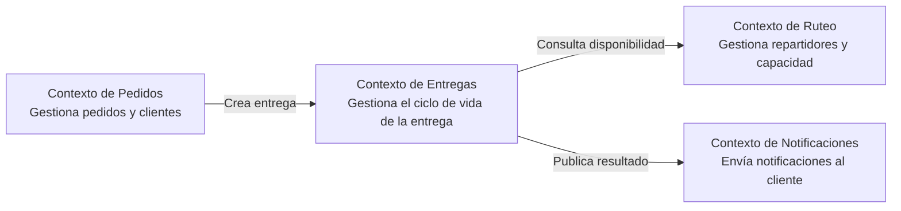
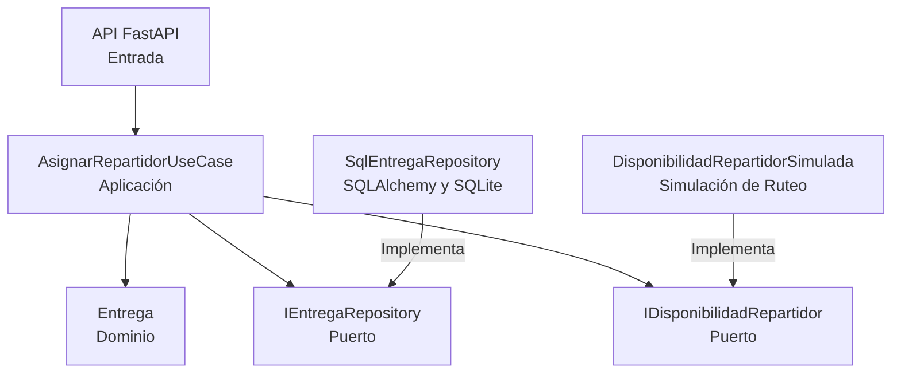

# Expediente arquitectónico de Rutify

Este documento reúne las decisiones y los diagramas de las cuatro actividades de Optativa 2 y muestra cómo se fueron conectando. Se actualizó en la Actividad 4, cuando el diseño se construyó y se probó.

## Recorrido por las actividades

| Actividad | Qué resolvió | Decisión principal | Repositorio |
|---|---|---|---|
| 1. Diagnóstico y contexto | Entender el problema: pedidos por varios canales, inventario repartido en distintos puntos y rutas sin información compartida | Un sistema centralizado que sea el punto único de verdad del estado de cada pedido, que se integra con los sistemas externos (pagos, geolocalización, notificaciones, ERP/CRM) en lugar de reemplazarlos | [rutify-actividad-1](https://github.com/jdmarin218-stack/rutify-actividad-1) |
| 2. Criterios arquitectónicos | Soportar la ventana de entrega sin romper las apps antiguas y aguantar picos de campaña | Monolito modular con límites claros entre Pedidos, Inventario, Ruteo y Entregas; la ventana como campo opcional; Ruteo detrás de una interfaz propia (ADR-001) | [rutify-actividad-2](https://github.com/jdmarin218-stack/rutify-actividad-2) |
| 3. Diseño y dominio | Modelar el flujo de asignar un repartidor a una entrega | La invariante vive en la entidad `Entrega`; el caso de uso depende solo de puertos; Ruteo se consulta con una respuesta simple de disponible o no disponible (ADR-002) | [rutify-actividad-3](https://github.com/jdmarin218-stack/rutify-actividad-3) |
| 4. Construcción y validación | Construir y probar ese flujo en código real | Vertical slice en Python con FastAPI y SQLite, pruebas en tres niveles, riesgos y señales de observabilidad | Este repositorio |

## Diagramas

### Contextos (sin cambios desde la Actividad 3)

Los contextos y sus relaciones siguen siendo los mismos. El flujo implementado vive en el Contexto de Entregas y simula al de Ruteo; Pedidos y Notificaciones quedaron fuera del corte.

### Componentes del Contexto de Entregas, tal como quedó implementado

Frente al diagrama de componentes de la Actividad 3 hay tres diferencias:

- La entrada HTTP (FastAPI) aparece explícita; en el diseño no estaba dibujada.
- El adaptador de base de datos es SQLAlchemy con SQLite, no EF Core.
- El adaptador hacia Ruteo es una simulación, no una llamada HTTP real, porque ese servicio no existe en este proyecto.

## Decisiones previas y qué pasó con ellas

| Decisión o condición | Origen | Qué ocurrió en la Actividad 4 |
|---|---|---|
| Monolito modular con límites claros | ADR-001 | Se respetó: un solo proceso con las capas separadas. |
| Costo aceptado: mantener los límites depende de la disciplina del equipo | ADR-001 | Se mitigó con `tests/unit/test_arquitectura.py`, que falla si el dominio o la aplicación importan infraestructura o frameworks. |
| Ruteo aislado detrás de una interfaz | ADR-001 | Se implementó como el puerto `IDisponibilidadRepartidor`, con un adaptador simulado. |
| Condición de revisión: si el puerto de disponibilidad no captura lo que Ruteo necesita expone, se ajusta el contrato sin tocar `Entrega` ni el caso de uso | ADR-002 | Con una respuesta booleana alcanzó para el flujo completo, así que el contrato no cambió. No se pudo probar contra el servicio real. |
| La invariante vive en la entidad | ADR-002 | Se cumplió y se verificó con pruebas unitarias y de integración. Además se encontró y corrigió un error de dominio que no se estaba traduciendo en la API (ver `actividad-4/observabilidad.md`). |
| Condición de revisión: extraer Ruteo si satura en campañas | ADR-001 | No se evaluó: esta actividad no mide carga. Sigue vigente. |

## Preguntas que siguen abiertas

Estas venían del diagnóstico de la Actividad 1 y esta actividad no las resolvió: cuántos puntos de almacenamiento hay y qué tan distribuidos están, si los repartidores son propios o tercerizados, cuál es el volumen diario de pedidos, qué tan maduros son los sistemas externos y cuáles son las reglas definitivas para asignar rutas. En el flujo implementado, la regla de asignación se reduce a "el repartidor tiene capacidad o no".

## Mapa de documentos

**Actividad 1:** [análisis del problema](https://github.com/jdmarin218-stack/rutify-actividad-1/blob/main/docs/actividad-1/analisis-problema.md), [supuestos y decisiones](https://github.com/jdmarin218-stack/rutify-actividad-1/blob/main/docs/actividad-1/supuestos-decisiones.md), [registro de riesgos](https://github.com/jdmarin218-stack/rutify-actividad-1/blob/main/docs/actividad-1/registro-riesgos.md), [diagrama de contexto](https://github.com/jdmarin218-stack/rutify-actividad-1/blob/main/docs/actividad-1/diagrama-contexto.svg).

**Actividad 2:** [ADR-001](https://github.com/jdmarin218-stack/rutify-actividad-2/blob/main/docs/actividad-2/adr-decision-estructural.md), [comparación de alternativas](https://github.com/jdmarin218-stack/rutify-actividad-2/blob/main/docs/actividad-2/comparacion-alternativas.md), [escenarios de calidad](https://github.com/jdmarin218-stack/rutify-actividad-2/blob/main/docs/actividad-2/escenarios-calidad.md), [criterios verificables](https://github.com/jdmarin218-stack/rutify-actividad-2/blob/main/docs/actividad-2/criterios-verificables.md).

**Actividad 3:** [Architecture.md](https://github.com/jdmarin218-stack/rutify-actividad-3/blob/main/Architecture.md), [modelo de dominio](https://github.com/jdmarin218-stack/rutify-actividad-3/blob/main/docs/actividad-3/modelo-dominio.md), [invariantes y escenarios](https://github.com/jdmarin218-stack/rutify-actividad-3/blob/main/docs/actividad-3/invariantes-escenarios.md), [contextos delimitados](https://github.com/jdmarin218-stack/rutify-actividad-3/blob/main/docs/actividad-3/contextos-delimitados.md), [ADR-002](https://github.com/jdmarin218-stack/rutify-actividad-3/blob/main/docs/actividad-3/adr-decision-diseno.md).

**Actividad 4:** [trazabilidad](actividad-4/trazabilidad.md), [decisiones tecnológicas](actividad-4/decisiones-tecnologicas.md), [riesgos](actividad-4/riesgos.md), [observabilidad](actividad-4/observabilidad.md).